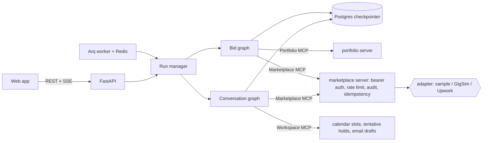

# GigBid (AI-4016): multi-agent freelancer copilot

LangGraph agents find freelance jobs, judge whether to bid, draft proposals where **every sentence links to portfolio
evidence**, and manage client replies. **A human approves every proposal and message before anything leaves the system.**

> **Status: working backend + UI + project-owned GigSim service.** Run `python -m scripts.run_gigsim --with-api` for the persistent synthetic marketplace, authenticated MCP and GigBid API. See [our GigSim documentation](docs/OWN_GIGSIM.md).
> Frontend deployment: [GigBid on Vercel](https://web-seven-dun-59.vercel.app) (currently access-protected; API and supporting services are not publicly deployed). [Workflow recording](evals/results/part_d_workflow.webm) and [Playwright results](evals/results/part_d_playwright.json).
> Dataset #1 from the TA's list is now ingested as real job text; synthetic personas, clients, labels, proposals and outcomes remain clearly distinguished.
> Real open-weight model runs are recorded separately from the historical heuristic baselines below. Development gold is synthetic and real outcome labels are unavailable; none of these evaluations measure marketplace performance. Dataset selection, attribution, licensing, preprocessing and limitations are documented in [docs/DATA_CARD.md](docs/DATA_CARD.md).

## Run it (verified from a clean venv on Linux; Windows untested)
```bash
python -m venv .venv && source .venv/bin/activate          # Windows: .venv\Scripts\activate
pip install -e ".[dev,postgres]"
pytest -q                          # latest WSL regression: 168 passed, 2 skipped; infrastructure checks need their services
python -m scripts.demo             # 5 sample jobs through the bid graph, stops at the human gate

# API (offline, heuristic LLM, sample marketplace)             # terminal 1
python -m uvicorn apps.api.main:create_app --factory --port 8000
# Web                                                          # terminal 2
cd apps/web && npm ci && npm run dev                           # http://127.0.0.1:3000
# login: reviewer@gigbid.test / reviewer-pass-1   (override with REVIEWER_EMAIL / REVIEWER_PASSWORD)

# evals (Windows has no `make`: run these four)
python -m evals.runners.rag_eval && python -m evals.runners.decision_eval && python -m evals.runners.injection_eval && python -m evals.runners.ablation
python -m evals.check_thresholds
```
Optional: `npm run test:contract` (API running) and `npx playwright install chromium && npm run test:e2e`; full stack:
`cp .env.example .env` (fill secrets, set `LLM_BACKEND=heuristic` to try without models) then `docker compose -f infra/docker-compose.yml --env-file .env up --build` (locally smoke-tested on 2026-11-15; see [the runbook](docs/RUNBOOK.md)).

## Run with the assignment dataset

Download version 1 of the [selected Kaggle dataset](https://www.kaggle.com/datasets/asaniczka/upwork-job-postings-dataset-2024-50k-records?datasetVersionNumber=1)
and save the original ZIP as `data/raw/upwork-job-postings-2024-v1.zip`. Install dependencies using the setup above, then run from the repository root:

```powershell
python -m scripts.prepare_dataset
python -m scripts.prepare_dataset --verify
python -m scripts.run_dataset --check
python -m scripts.run_dataset
```

The preparation command verifies the documented archive checksum and regenerates the real/synthetic corpus and development sets with seed 7.
Verification rebuilds in a temporary directory and compares corpus and dev outputs without replacing them. JSON key order and Python version metadata may differ; each manifest's file hashes are independently checked.
The launcher selects the same versioned directory for marketplace jobs and portfolio evidence and defaults to the offline heuristic backend.
Start the web frontend in a second terminal as above. The dataset launcher reads `.env`; direct `uvicorn` startup does not automatically read it.
On the configured WSL installation, `python -m scripts.run_frontend` starts the frontend with the cached Node runtime at `http://localhost:3000`, proxying API requests to port 8000. It also works with system Node when no cached runtime is present.
For Docker, prepare the corpus before building images and use `GIGBID_DATA_DIR=data/processed/kaggle_2024_v1` in `.env`;
Compose passes this path to the API, worker, marketplace and portfolio services.

Raw and processed records are git-ignored: reproduce them using these commands rather than expecting them in a fresh checkout.
See [the data card](docs/DATA_CARD.md) for attribution, licensing, synthetic labels and the assumed USD currency limitation,
and [dataset submission notes](docs/DATASET_SUBMISSION.md) for the report-ready summary and validation status.

## Architecture

Bid graph: `load_job → [analyst | risk | fit_matcher] (parallel, Send) → decide → pricing → writer → verifier → critic (≤2 revisions) → compliance → interrupt() approval → submit → learn`.
Details: [docs/ARCHITECTURE.md](docs/ARCHITECTURE.md), tools: [docs/TOOLS.md](docs/TOOLS.md), ops: [docs/RUNBOOK.md](docs/RUNBOOK.md).

## Real open-weight model comparison

Qwen2.5 1.5B and 0.5B run through the actual bid graph on the same 20 seeded development jobs per persona, with GPU inference on an RTX 4050.
The 19 persona/job pairs used for initial prompt/runtime diagnostics are excluded. The graph stops at approval and sends no proposals.
See [measured results and the local configuration choice](docs/OPEN_MODEL_RESULTS.md), [reproduction and limitations](docs/OPEN_MODEL_COMPARISON.md),
and the complete per-job evidence in `evals/results/open_model_comparison.json`. This is a synthetic development subset, not the full instructor evaluation.
On the configured WSL installation, start the model service with `python -m scripts.local_models` and the API with `python -m scripts.run_dataset`.
The launcher reads the ignored `.env` and prints the actual backend and node models.

## Actual agent behavior verified

The selected real model passed **25 HTTP behavior checks** <!-- result: real_agent_behaviour.json:passed = 25 -->,
including approval across a SQLite API restart, mock-only submission after approval, unsafe-edit blocking, calendar-backed replies,
bounded Critic revisions and model-failure handling. See [the behavior report](docs/REAL_AGENT_BEHAVIOUR.md) and its raw traces.
The local dataset launcher now keeps checkpoints, users, runs and a persistent session key in the ignored `.local-models/api-state` directory;
explicit database/secret environment settings take precedence.
This verifies local agent/API behavior; it is not a browser, GigSim, Postgres/Redis durability or real marketplace outcome test.
The numeric two-model study above predates this guard hardening and remains a historical benchmark snapshot.

## Results (TOY: 5 sample jobs, test-double LLM. Not valid for the report)
Every number below is checked against `evals/results/*.json` by `scripts/check_repo_rules.py`.

| Check | Value | Source |
|---|---|---|
| bid-or-skip F1 | 1.0 <!-- result: decision_eval.json:base.bid_or_skip.f1 = 1.0 --> | decision_eval.json |
| scam/injection recall | 1.0 <!-- result: decision_eval.json:base.scam_or_injection_detection.recall = 1.0 --> | decision_eval.json |
| unsupported claims per proposal, fabricating writer, verifier OFF | 1.0 <!-- result: decision_eval.json:fabricating_writer_verifier_off.unsupported_claims_per_proposal_after = 1.0 --> | decision_eval.json |
| same, verifier ON | 0.0 <!-- result: decision_eval.json:fabricating_writer_verifier_on.unsupported_claims_per_proposal_after = 0.0 --> | decision_eval.json |
| injection attack success, known patterns, defence ON | 0.0 <!-- result: injection_eval.json:known_patterns.defence_on.attack_success_rate = 0.0 --> | injection_eval.json |
| injection attack success, **paraphrased** attacks, defence ON | 1.0 <!-- result: injection_eval.json:paraphrased_unseen.defence_on.attack_success_rate = 1.0 --> | injection_eval.json |

The last row is a finding, not a failure: the regex floor stops known injection phrasings and is beaten by paraphrases.
The "model" in that eval is a simulated gullible LLM, so it shows the defence logic, not a real model's susceptibility.

### Synthetic corpus (3 personas x 200 dev jobs; test-double LLM; hashing embedder). Still not valid for the report
Regenerate: see [docs/DATA_CARD.md](docs/DATA_CARD.md) section 7. The first rows show why decision metrics need held-out data: the detector is perfect on
templates it was written against and blind to rewordings, so the real Risk Assessor LLM (not run yet) is what must close that gap.
Decomposition (V1) clearly beats the naive baseline on retrieval here; that is a retrieval result on synthetic text, not evidence about reply rates.

| Check | Value | Source |
|---|---|---|
| Held-out scam/injection recall (rule-based risk, no real LLM), AI/ML persona | 0.0 <!-- result: decision_eval_ai-ml-engineer.json:base.scam_or_injection_recall_by_template_set.heldout.recall = 0.0 --> | decision_eval_ai-ml-engineer.json |
| Seeded scam/injection recall (circular, easy), same persona | 1.0 <!-- result: decision_eval_ai-ml-engineer.json:base.scam_or_injection_recall_by_template_set.seeded.recall = 1.0 --> | decision_eval_ai-ml-engineer.json |
| Bid-or-skip F1, AI/ML persona | 0.9625 <!-- result: decision_eval_ai-ml-engineer.json:base.bid_or_skip.f1 = 0.9625 --> | decision_eval_ai-ml-engineer.json |
| RAG MRR, V0 naive | 0.6744 <!-- result: rag_eval_ai-ml-engineer.json:variants.v0_naive.mrr = 0.6744 --> | rag_eval_ai-ml-engineer.json |
| RAG MRR, V1 decomposition | 0.9454 <!-- result: rag_eval_ai-ml-engineer.json:variants.v1_decomposed.mrr = 0.9454 --> | rag_eval_ai-ml-engineer.json |
| RAG Recall@5, V0 naive | 0.2965 <!-- result: rag_eval_ai-ml-engineer.json:variants.v0_naive.recall@5 = 0.2965 --> | rag_eval_ai-ml-engineer.json |
| RAG Recall@5, V1 decomposition | 0.3662 <!-- result: rag_eval_ai-ml-engineer.json:variants.v1_decomposed.recall@5 = 0.3662 --> | rag_eval_ai-ml-engineer.json |

## Done and tested (backend) / built (UI)
Two LangGraph graphs with interrupt-based approval and verified SQLite kill/restart/resume behavior; Postgres checkpointer code exists, but its infrastructure checks remain skipped locally;
three own MCP servers (portfolio, marketplace, workspace) with schemas, annotations, idempotency keys, dry-run, bearer auth,
rate limit, PII-masked audit log; per-agent tool allowlists; V0, V1, V2, V3, V8 retrieval variants; claim verification;
style/outcome memory with explicit promotion rules and user deletion; FastAPI with SSE, tenant scoping, degraded mode;
Arq worker (restart-safe); eval runners, metrics, CI threshold gate.
UI (all nine screens): builds and typechecks. Playwright has **14 passing project runs across 12 unique tests** (12 desktop, 2 phone) <!-- result: part_d_playwright.json:stats.expected = 14 --> covering onboarding/settings, approvals, evidence tooltips, refresh, edits, rejection/analytics, degraded recovery, portfolio ingestion, provider confirmation, paragraph regeneration, and the recorded inbox-to-reply workflow. See [browser test evidence and limits](docs/FRONTEND_TESTS.md). The separate vitest contract test also drives the typed client and SSE reader against a live API.

B1 portfolio ingestion supports PDF CVs, Markdown case studies, GitHub MCP README/code imports, reviews and past proposals with outcomes. Add work in Settings; required chunk metadata, incremental indexing and MCP retrieval update immediately. See [portfolio ingestion](docs/PORTFOLIO_INGESTION.md).

B2 provides configurable V0/V1/V2/V3/V8, fixed chunks, real neural backends, MCP layer routing and a bounded corrective LangGraph. Run `python -m evals.rd_b.compare_variants` to regenerate the required-variant comparison. The preregistered one-component ablation is in [R&D B results](docs/RD_B_ABLATION_RESULTS.md); run `python -m evals.rd_b.run_ablation` and `python -m evals.rd_b.report_ablation` to regenerate its raw run and tables. Dataset provenance and synthetic-label limits are in [DATA_CARD.md](docs/DATA_CARD.md).

B3 verifies sentence-level claims before Critic, with source/citation guards and real-model semantic checks. A measured real-model run labeled 6/43 units unsupported before filtering and 0/22 after; two drafts became empty and were blocked. These are checker labels on synthetic development evidence, not human-calibrated truth judgments. See [verification results and limits](docs/CLAIM_VERIFICATION.md).

## B5 integrated results

| Variant | Evidence Recall@5 | Evidence nDCG@10 | Unsupported claims / proposal | Judge score (0–4) | GigSim reply rate | p95 latency (s) | Cost / proposal (USD) |
|---|---:|---:|---:|---:|---:|---:|---:|
| V0 naive | 0.2600 | 0.4700 | 0.00 (0/45) | 3.00 (n=45; uncalibrated) | 48.6% (18/37) | 51.08 | n/a* |
| **Your best: V8 corrective** | **0.3510** | **0.5792** | 0.00 (0/50) | 2.94 (n=50; uncalibrated) | 48.6% (17/35) | 53.43 | n/a* |

V8 is the descriptive retrieval leader among the five required B2 variants; it is not a statistically established winner. Retrieval uses 600 synthetic development jobs (338 with nonempty synthetic evidence gold). Remaining columns use the separate B4 exploratory cohort of 50 sampled jobs per persona and variant: 300 attempts, 295 completed decisions, five model/output errors. Claim counts are model-verifier labels; judge scores are uncalibrated (30 author labels: 11/30 agreement, Cohen's κ=0.000). GigSim replies are from the project-owned scripted simulator and use submitted proposals only. P95 is end-to-end graph latency for successfully produced proposals. *USD inference cost is n/a for these local runs: provider API charges were $0, but hardware/electricity cost was not measured. Full B4 is still incomplete (16/1,200 runs), and the classmate panel is pending. Detailed methodology and result provenance: [R&D B report](docs/RD_B_RESULTS.md); raw summaries: `evals/results/b2/summary.json` and `evals/results/b4_exploratory/summary.json`.

## R&D C: single agent vs supervisor vs hand-built graph

The same local `qwen25-15b` model and frozen set of 50 distinct synthetic jobs were run through all three architectures (150 trials). Failures count as incorrect. The comparison is exploratory and is not evidence about real clients or hiring.

| Architecture | Bid/skip accuracy | Completed / failures | Unsupported claims / proposal | Compliance caught / found | GigSim replies / submissions (rate) | Mean tokens / completed job | p95 latency (s) |
|---|---:|---:|---:|---:|---:|---:|---:|
| Single ReAct agent | 0.34 | 47 / 3 | 4.51 | 13 / 13 | 9 / 27 (33.3%) | 5,638 | 30.59 |
| `langgraph-supervisor` | 0.36 | 48 / 2 | 4.04 | 0 / 0 | 9 / 32 (28.1%) | 5,872 | 16.81 |
| Hand-built GigBid graph | **0.98** | 50 / 0 | **1.35** | 0 / 0 | 1 / 1 (100%) | **4,224** | 22.76 |

On this risk-enriched sample, the hand-built graph had higher bid/skip accuracy in ordinary jobs (0.967) and scam/injection jobs (1.00) than either baseline; ReAct and supervisor scored 0.00 on scam and injection. ReAct and the supervisor also submitted 15/27 and 18/32 proposals, respectively, for jobs whose synthetic gold action was skip. One ReAct submission on an injection-labeled skip job passed the current risk/compliance gate and received a scripted simulator reply; see the [approved-proposal trace](evals/results/rd_c_traces/approved_proposal.json). This is a safety failure, not a positive outcome. The hand-built graph's 100% reply rate is only 1/1 submission; simulator replies and synthetic labels must not be interpreted as marketplace performance. The graph used fewer mean tokens than both baselines but had higher p95 latency than the supervisor. There is no job type where ReAct beats the graph on accuracy in this sample, but the result is not generalizable and cannot isolate a real-market benefit from the synthetic rule-based labels and risk gates.

Full persona/job-type tables, preregistration, raw trials, graph renderings, and traces: [R&D C results](docs/RD_C_RESULTS.md), [`rd_c_comparison.json`](evals/results/rd_c_comparison.json), and [`rd_c_trials.jsonl`](evals/results/rd_c_trials.jsonl). Local provider API charges were $0; this is not total inference cost. Output tokens/sec is reported in the analytics UI, while hardware/electricity costs were not measured. Paid-profile USD estimates require exact token usage and configured model rates; otherwise the UI shows n/a.

## Not done (be honest in the report)
- **Real-world outcome evaluation** (the ingested Upwork posts contain no outcomes/labels) and the instructor's hidden test run. Dataset #1's schema and mapping are verified, but upstream rights and currency are not independently confirmed beyond Kaggle metadata. The project-owned GigSim REST service and contract adapter are tested; `localsim.py` models simulated clients (rule-based clients: rates are relative, not real).
- **Live third-party verification limits:** Upwork OAuth and real account reads passed; live writes were not exercised. Official GitHub MCP integration and README ingestion are implemented and tested locally; GitHub account authorization is pending. See [Upwork evidence](docs/UPWORK_LIVE.md) and [GitHub integration](docs/GITHUB_MCP.md).
- **Full instructor-data model evaluation**: the real open-weight comparison above uses a synthetic dev subset. Historical tables below it retain their heuristic/test-double labels. Human quality validation and real outcomes remain outstanding.
- **Classmate panel, hardware/electricity cost accounting and Langfuse/LangSmith integration** remain outstanding. The 30-label judge calibration was measured but showed no agreement beyond chance (κ=0.000), so judge scores are not calibrated. Local inference reports throughput but hardware/electricity costs remain unmeasured. R&D A has a lexical tool-selection baseline, R&D B has measured retrieval/decision comparisons, and R&D C has a 50-job synthetic architecture comparison; see `docs/RD_A_RESULTS.md`, `docs/RD_B_RESULTS.md`, and `docs/RD_C_RESULTS.md` for their scopes and caveats.
- **Variants V4-V7 and V9 are not implemented.** Portfolio ingestion, incremental indexing, upload and one-paragraph regeneration are implemented.
- **Signature extension** ([docs/EXTENSION.md](docs/EXTENSION.md)), deployment, write-up, R&D report ([docs/REPORT_CHECKLIST.md](docs/REPORT_CHECKLIST.md)).
- **Broader browser/mobile coverage**: Chromium desktop and phone projects are tested; Firefox/WebKit and every authenticated screen at phone width are not. The deterministic browser fixtures do not replace real-model API evaluation.
- `docker compose` files are written and parse but were never started.
