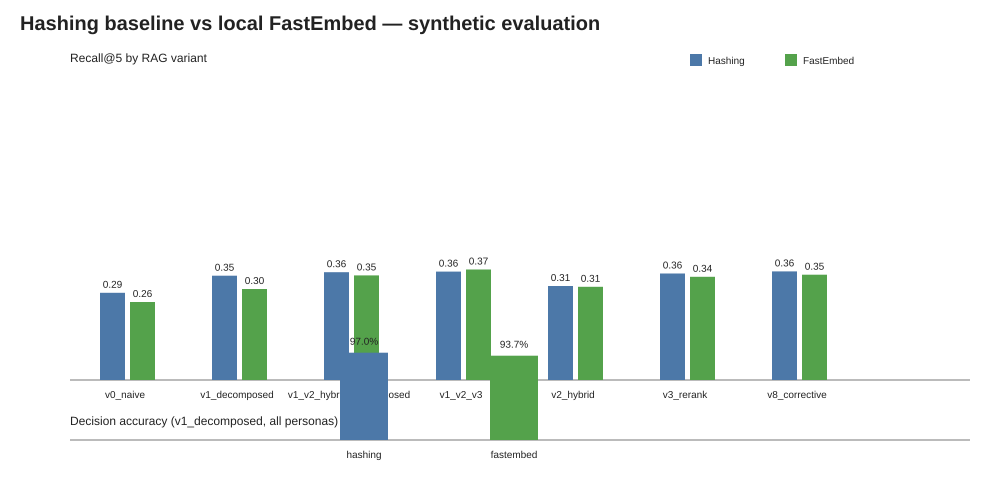

# R&D B — Real Embedding Model Evaluation

> **Synthetic/local evaluation only.** The instructor development dataset is not present. The dev jobs are generated synthetic text with rule-derived labels; portfolio evidence and freelancer profiles are generated. No result here is evidence of real marketplace performance.

## Preregistered one-component ablation

The original five-variant comparison was exploratory and had no preregistered hypothesis. Before the new run, [the frozen protocol](RD_B_PREREGISTRATION.md) predicted that the composite V1 decomposition + V2 hybrid + V3 cross-encoder pipeline would exceed V0 by 0.10 Recall@5, that removing each component would lower Recall@5 by at least 0.01, and that the uplift on 4+ requirement jobs would be at least 0.15. This preregistration followed inspection of the earlier results, so the rerun is not an independent replication.

| Condition | Recall@5 (n=338) | nDCG@10 | p95 retrieval (ms) | Full minus condition Recall@5 |
|---|---:|---:|---:|---:|
| V0 naive | 0.2600 | 0.4700 | 55.1 | +0.0607 |
| Full: V1+V2+V3 | 0.3206 | 0.5498 | 921.9 | reference |
| No decomposition | 0.2803 | 0.5055 | 1,679.1 | +0.0403 |
| No hybrid | 0.3206 | 0.5498 | 568.7 | 0.0000 |
| No cross-encoder reranking | **0.3487** | **0.5784** | **47.1** | -0.0281 |

The 0.10 primary Recall@5 threshold and 0.15 high-complexity threshold were not met; the 4+ skill uplift was 0.050 over V0 (n=260). Decomposition helped this candidate (+0.0403 over its removal), hybrid fusion made no measured difference, and removing the cross-encoder improved Recall@5 by 0.0281 while reducing p95 by about 875 ms. These are paired descriptive results on synthetic labels, not real-market or causal claims. Full persona, category, synthetic risk-type, and B4 reply-rate tables are generated in [RD_B_ABLATION_RESULTS.md](RD_B_ABLATION_RESULTS.md).

The ablation runner explicitly used the FastEmbed cross-encoder. The earlier `run_real_embedder.py` composite used the checked-in config's lexical reranker default; therefore its composite score is not a same-model baseline for this new run. All within-run comparisons hold the cross-encoder fixed except the no-reranker condition. The report also clarifies that 22 scam and 16 injection rows had positive synthetic evidence gold; only rows with no gold are excluded from Recall/nDCG.

**What ships:** keep `v1_decomposed` as the configured default. Do not promote the composite solely because it retrieves more: the cross-encoder ablation was slower and worse on this run, B4 V0/V8 simulated reply rates were both 48.6%, and the proposal judge has κ=0. The ablation variant implementation and table regeneration commands are in `evals/rd_b/ablation_variants.py`, `evals/rd_b/run_ablation.py`, and `evals/rd_b/report_ablation.py`. Dataset provenance is in [DATA_CARD.md](DATA_CARD.md).

## Setup and reproducibility

- Corpus: `data\processed\kaggle_2024_v1`; processed corpus manifest SHA-256 `21a81829334590fcdb0e917f36fc832d1bdbf87f75a33eb9852dbd816a5f6894`; corpus build seed `7`.
- Evaluation seed: `4016`. Evaluation uses the same jobs and evidence IDs under both embedder conditions.
- Synthetic dev examples: ai-ml-engineer: 200, fullstack-dev: 200, data-analyst: 200; label provenance `synthetic_rule`. Gold is synthetic/rule-derived, not human-labelled.
- Baseline: HashingEmbedder, 512 dimensions, in-repo deterministic test baseline. Real open embedder: `sentence-transformers/all-MiniLM-L6-v2` via FastEmbed 0.9.1, source `Qdrant/all-MiniLM-L6-v2-onnx`, revision `d13954661f83248295ba75c1ed411eef3b7b936e`, model-file SHA-256 `bbd7b466f6d58e646fdc2bd5fd67b2f5e93c0b687011bd4548c420f7bd46f0c5`, 384 dimensions, license `apache-2.0`.
- Vector index: DenseIndex: in-memory NumPy cosine similarity; not an external vector database. All 88 portfolio evidence records were embedded again for each condition. Saved vector files and hashes are listed in `evals/rd_b/results/results.json`.
- Retrieval latency includes per-query embedding and search, but not one-time index construction; index build times are separately recorded. RAG variants: v0_naive, v1_decomposed, v1_v2_hybrid_decomposed, v1_v2_v3, v2_hybrid, v3_rerank, v8_corrective. Decision graph variants: `v1_decomposed, v1_v2_v3` with `HeuristicLLM deterministic test double` and the existing lexical claim verifier.

## B5 integrated results table

| Variant | Evidence Recall@5 | Evidence nDCG@10 | Unsupported claims / proposal | Judge score (0–4) | GigSim reply rate | p95 latency (s) | Cost / proposal (USD) |
|---|---:|---:|---:|---:|---:|---:|---:|
| V0 naive | 0.2600 | 0.4700 | 0.00 (0/45) | 3.00 (n=45; uncalibrated) | 48.6% (18/37) | 51.08 | n/a* |
| **Your best: V8 corrective** | **0.3510** | **0.5792** | 0.00 (0/50) | 2.94 (n=50; uncalibrated) | 48.6% (17/35) | 53.43 | n/a* |

V8 is selected as “Your best” because it has the highest aggregate Recall@5 and nDCG@10 among the five required variants in the B2 neural-retrieval comparison; this is descriptive, not statistical evidence of superiority. Retrieval metrics come from 600 synthetic development jobs, with relevance metrics over 338 jobs with nonempty synthetic gold. Unsupported-claim, judge, GigSim reply, latency and cost figures come from the separate B4 exploratory cohort: 50 sampled jobs per persona for each variant (300 attempts; 295 decisions completed; five model/output errors retained). Unsupported claims are post-verifier model labels. Judge scores are not calibrated: on 30 author-labeled items agreement was 11/30 (36.7%) and Cohen's κ=0.000. Reply rates use submitted proposals only and the project-owned scripted GigSim, not real marketplace outcomes. P95 is end-to-end graph latency among successfully produced proposals. *USD inference cost is n/a for these local runs: provider API charges were $0; hardware/electricity cost was not measured. The B4 full protocol remains paused at 16/1,200 runs, and the blind classmate panel has no ratings. See `evals/results/b2/summary.json` and `evals/results/b4_exploratory/summary.json` for source data.

## Retrieval results

| Variant | Queries | Hash Recall@5 | FastEmbed Recall@5 | Δ | Hash MRR | FastEmbed MRR | Δ | Hash nDCG@10 | FastEmbed nDCG@10 | Hash median ms | FastEmbed median ms |
|---|---:|---:|---:|---:|---:|---:|---:|---:|---:|---:|---:|
| `v0_naive` | 338 | 0.2907 | 0.2600 | -0.0307 | 0.6662 | 0.6588 | -0.0074 | 0.5220 | 0.4700 | 0.398 | 8.604 |
| `v1_decomposed` | 338 | 0.3476 | 0.3033 | -0.0444 | 0.9052 | 0.7762 | -0.1290 | 0.6123 | 0.5150 | 0.829 | 7.934 |
| `v1_v2_hybrid_decomposed` | 338 | 0.3595 | 0.3487 | -0.0107 | 0.9144 | 0.8726 | -0.0418 | 0.6115 | 0.5784 | 0.599 | 20.462 |
| `v1_v2_v3` | 338 | 0.3613 | 0.3683 | +0.0070 | 0.8897 | 0.8943 | +0.0046 | 0.6098 | 0.6162 | 1.271 | 22.064 |
| `v2_hybrid` | 338 | 0.3132 | 0.3107 | -0.0026 | 0.6663 | 0.6887 | +0.0224 | 0.5514 | 0.5469 | 0.378 | 8.279 |
| `v3_rerank` | 338 | 0.3550 | 0.3439 | -0.0111 | 0.7882 | 0.7752 | -0.0130 | 0.6038 | 0.5876 | 0.585 | 8.839 |
| `v8_corrective` | 338 | 0.3621 | 0.3510 | -0.0111 | 0.9144 | 0.8729 | -0.0415 | 0.6131 | 0.5792 | 0.852 | 20.643 |

### Retrieved relevant evidence and latency

| Embedder | v1 relevant evidence retrieved @5 / relevant total | Recall@5 micro | Median query latency (ms) | P95 query latency (ms) |
|---|---:|---:|---:|---:|
| Hashing baseline | 940/2704 | 0.3476 | 0.829 | 3.745 |
| FastEmbed open model | 820/2704 | 0.3033 | 7.934 | 12.791 |

## Downstream bid/skip and claim checks

| Decision variant | Persona | Embedder | N | Accuracy | Bid F1 | Bid precision | Bid recall | Supported claims | Partly supported | Unsupported | Graph median ms |
|---|---|---|---:|---:|---:|---:|---:|---:|---:|---:|---:|
| `v1_decomposed` | ai-ml-engineer | Hashing baseline | 200 | 97.0% | 0.9625 | 92.8% | 100.0% | 100.0% | 0.0% | 0.0% | 8.23 |
| `v1_decomposed` | ai-ml-engineer | FastEmbed open model | 200 | 96.0% | 0.9554 | 92.6% | 98.7% | 100.0% | 0.0% | 0.0% | 16.97 |
| `v1_decomposed` | fullstack-dev | Hashing baseline | 200 | 95.5% | 0.9524 | 90.9% | 100.0% | 100.0% | 0.0% | 0.0% | 10.14 |
| `v1_decomposed` | fullstack-dev | FastEmbed open model | 200 | 91.0% | 0.9419 | 92.0% | 96.4% | 100.0% | 0.0% | 0.0% | 17.54 |
| `v1_decomposed` | data-analyst | Hashing baseline | 200 | 98.5% | 0.9838 | 96.8% | 100.0% | 100.0% | 0.0% | 0.0% | 9.18 |
| `v1_decomposed` | data-analyst | FastEmbed open model | 200 | 94.0% | 0.9818 | 97.6% | 98.8% | 100.0% | 0.0% | 0.0% | 17.48 |
| `v1_decomposed` | **All personas** | **Hashing baseline** | **600** | **97.0%** | **0.9663** | **93.5%** | **100.0%** | **100.0%** | **0.0%** | **0.0%** | **9.56** |
| `v1_decomposed` | **All personas** | **FastEmbed open model** | **600** | **93.7%** | **0.9595** | **94.0%** | **97.9%** | **100.0%** | **0.0%** | **0.0%** | **17.37** |
| `v1_v2_v3` | ai-ml-engineer | Hashing baseline | 200 | 97.0% | 0.9625 | 92.8% | 100.0% | 100.0% | 0.0% | 0.0% | 9.45 |
| `v1_v2_v3` | ai-ml-engineer | FastEmbed open model | 200 | 97.0% | 0.9625 | 92.8% | 100.0% | 100.0% | 0.0% | 0.0% | 31.38 |
| `v1_v2_v3` | fullstack-dev | Hashing baseline | 200 | 95.5% | 0.9524 | 90.9% | 100.0% | 100.0% | 0.0% | 0.0% | 12.27 |
| `v1_v2_v3` | fullstack-dev | FastEmbed open model | 200 | 95.0% | 0.9519 | 90.8% | 100.0% | 100.0% | 0.0% | 0.0% | 31.02 |
| `v1_v2_v3` | data-analyst | Hashing baseline | 200 | 98.5% | 0.9838 | 96.8% | 100.0% | 100.0% | 0.0% | 0.0% | 10.16 |
| `v1_v2_v3` | data-analyst | FastEmbed open model | 200 | 98.5% | 0.9838 | 96.8% | 100.0% | 100.0% | 0.0% | 0.0% | 30.82 |
| `v1_v2_v3` | **All personas** | **Hashing baseline** | **600** | **97.0%** | **0.9663** | **93.5%** | **100.0%** | **100.0%** | **0.0%** | **0.0%** | **10.64** |
| `v1_v2_v3` | **All personas** | **FastEmbed open model** | **600** | **96.8%** | **0.9662** | **93.5%** | **100.0%** | **100.0%** | **0.0%** | **0.0%** | **30.99** |

### Paired results by persona (v1_decomposed)

| Persona | Paired jobs | Recall@5 improved | Recall@5 decreased | Decisions changed | Decision correctness improved | Decreased |
|---|---:|---:|---:|---:|---:|---:|
| ai-ml-engineer | 113 | 40 | 41 | 2 | 0 | 2 |
| data-analyst | 108 | 28 | 55 | 11 | 1 | 10 |
| fullstack-dev | 117 | 22 | 67 | 11 | 0 | 9 |

### Paired downstream comparison by decision variant

This subset contains only job/persona rows with at least one gold evidence item and matches the retrieval variant to the decision variant.

| Variant | Paired rows | Hash accuracy | FastEmbed accuracy | Δ accuracy | Recall improved | Recall decreased | Improved recall, unchanged correctness | Recall drop with correctness drop |
|---|---:|---:|---:|---:|---:|---:|---:|---:|
| `v1_decomposed` | 338 | 94.7% | 88.8% | -5.9% | 90 | 163 | 89 | 16 |
| `v1_v2_v3` | 338 | 94.7% | 94.4% | -0.3% | 113 | 103 | 113 | 1 |

All-job decision accuracy is also reported above; paired accuracy here is restricted to rows with relevant evidence so that each decision can be aligned with retrieval metrics.

## Does better retrieval improve decisions?

Each decision comparison below is paired with retrieval on the same persona/job and matching variant; rows have at least one gold evidence item (retrieval metrics are undefined for no-relevance cases). All-job decision metrics, including no-relevance cases, are reported separately above.

Examples of retrieval/decision divergence (descriptive association, not proof of causation):

| Variant | Pattern | Persona | Job ID | Δ recall@5 | Baseline action | FastEmbed action | Correctness baseline → FastEmbed |
|---|---|---|---|---:|---|---|---|
| `v1_decomposed` | Recall improved / correctness unchanged | — | — | — | — | — | 89 cases (4 remained incorrect) |
| `v1_decomposed` | Recall improved / correctness unchanged | ai-ml-engineer | `inj-200132` | +0.1250 | bid | bid | False → False |
| `v1_decomposed` | Recall improved / correctness unchanged | ai-ml-engineer | `scam-200051` | +0.1250 | bid | bid | False → False |
| `v1_decomposed` | Recall improved / correctness unchanged | ai-ml-engineer | `scam-200086` | +0.2500 | skip | skip | True → True |
| `v1_decomposed` | Recall decreased / correctness harmed | ai-ml-engineer | `syn-101288` | -0.1250 | bid | skip | True → False |
| `v1_decomposed` | Recall decreased / correctness harmed | ai-ml-engineer | `syn-101039` | -0.2500 | bid | watch | True → False |
| `v1_decomposed` | Recall decreased / correctness harmed | fullstack-dev | `syn-100849` | -0.2500 | bid | watch | True → False |
| `v1_decomposed` | Recall decreased / correctness improved | data-analyst | `inj-200146` | -0.1250 | bid | skip | False → True |
| `v1_decomposed` | **Paired summary** | **338 rows** | — | — | — | — | Recall improved 90; unchanged 85; decreased 163. Decision accuracy: 94.7% → 88.8%; actions changed 24; correctness improved 1 / decreased 21. |
| `v1_v2_v3` | Recall improved / correctness unchanged | — | — | — | — | — | 113 cases (9 remained incorrect) |
| `v1_v2_v3` | Recall improved / correctness unchanged | ai-ml-engineer | `inj-200112` | +0.1250 | bid | bid | False → False |
| `v1_v2_v3` | Recall improved / correctness unchanged | ai-ml-engineer | `syn-100002` | +0.1250 | bid | bid | True → True |
| `v1_v2_v3` | Recall improved / correctness unchanged | ai-ml-engineer | `syn-100149` | +0.1250 | bid | bid | True → True |
| `v1_v2_v3` | Recall decreased / correctness harmed | fullstack-dev | `syn-100790` | -0.1250 | bid | watch | True → False |
| `v1_v2_v3` | **Paired summary** | **338 rows** | — | — | — | — | Recall improved 113; unchanged 122; decreased 103. Decision accuracy: 94.7% → 94.4%; actions changed 1; correctness improved 0 / decreased 1. |

This paired comparison is descriptive. Better-ranked evidence may not change the rule-based fit threshold, risk decision, or generated proposal; the heuristic writer and formula-derived gold are authored together. Decision changes cannot be attributed to retrieval alone, and no significance test is claimed.

## Limitations and instructor-data handoff

- All dev jobs in this run are synthetic generated jobs with synthetic rule-derived gold; all freelancer portfolios are synthetic. The source Kaggle postings have no bid/skip or evidence relevance labels. No instructor development dataset was available.
- The claim verifier is lexical and the writer is a deterministic test double; claim support categories are not human judgments. The generated writer's claims were all labelled supported in this run; that is not evidence that claims are factually true in practice.
- There is no model-generated token usage or inference API cost in this experiment. FastEmbed inference is local; local CPU time is captured in retrieval/index latency.
- The synthetic corpus is small. This experiment evaluates a local dense NumPy index, not a production vector database or live marketplace.
- The hashing baseline and FastEmbed condition use the same portfolio items, filters, top-k, RAG variant, dev jobs, decision graph, and heuristic writer.
- To evaluate instructor data later, provide a corpus with `jobs.json`, `portfolio_items.json`, `freelancers.json`, and `DATA_MANIFEST.json`, plus `dev_<persona>.json` files with `job_id`, `gold_action`, and `gold_evidence`; then run `python -m evals.rd_b.run_real_embedder --data-dir <corpus> --dev-dir <dev-dir>`. Use the source's actual labels and provenance; do not relabel synthetic data as instructor ground truth.
- Full per-job rankings, retrieved IDs, decisions, and claim verdicts are in `evals/rd_b/results/`; run `python -m evals.rd_b.analyze_retrieval` to rebuild this report and chart. No real marketplace performance is claimed.
